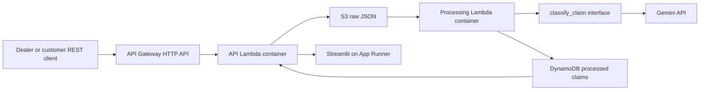

# Final pipeline implementation

1. **Ingestion:** `POST /claims` accepts the Phase 1 complaint fields as JSON. The API Lambda validates and stores the raw report, then returns `202`.
2. **Storage:** S3 stores raw JSON under `raw/{complaint_id}.json`. Public access is blocked, default encryption and versioning are enabled. The source CSV remains a portable bulk format.
3. **Preprocessing:** An S3 object-created event invokes a containerized Lambda. `cloud.pipeline` validates the claim and masks common VIN, phone, and email patterns before inference.
4. **AI inference:** The portable pipeline calls `classify_claim(text, provider)`. `cloud.ai.GeminiClassifier` owns the Gemini REST request. `MockClassifier` exists only for local demonstration and tests; AWS explicitly constructs Gemini. The issue families use the eight themes discovered in Phase 2.
5. **Operational storage:** DynamoDB stores one processed item per complaint ID. The worker skips a repeated S3 object with the same ETag and uses a conditional write to avoid duplicate final records. Lambda retries failed events and sends exhausted failures to SQS.
6. **Dashboard:** Streamlit reads the authenticated REST API and runs in an App Runner container. Viewers enter the shared access token before seeing issue counts, monthly trends, review flags, or complaint text.
7. **Infrastructure:** Terraform provisions ECR, Secrets Manager, S3, DynamoDB, Lambda, API Gateway, App Runner, IAM, logs, and a failure queue.

## Portability and limits

The API uses standard HTTP and raw data uses JSON/CSV. `cloud.core`, `cloud.ai`, `cloud.pipeline`, and `cloud.queries` contain no AWS SDK calls. `cloud.aws_handlers` is an AWS-specific adapter. A move to Cloud Run or Azure would reuse core logic and the container source but replace the event, storage, and deployment adapters.

The image is a standard Python container with the AWS runtime interface client in its Lambda entry point. Docker packaging helps portability; it does not remove the Lambda event contract. Terraform keeps the infrastructure workflow consistent, but its AWS resource definitions must be replaced for another provider. DynamoDB and App Runner are AWS-specific choices. PostgreSQL would reduce database lock-in but add setup and operations for this course-sized deployment.

The demonstration uses one shared bearer token and a full-table summary scan. For real dealer/customer data, add user identity and access controls, a stronger privacy review before sending text to Gemini, and precomputed aggregates. The current regex masking cannot guarantee removal of all personal information.
